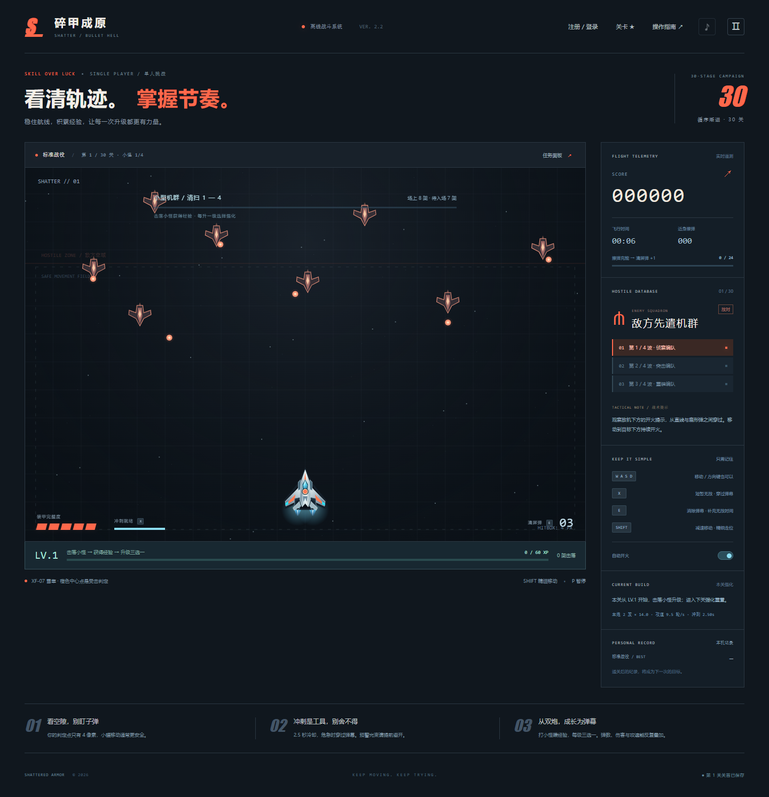
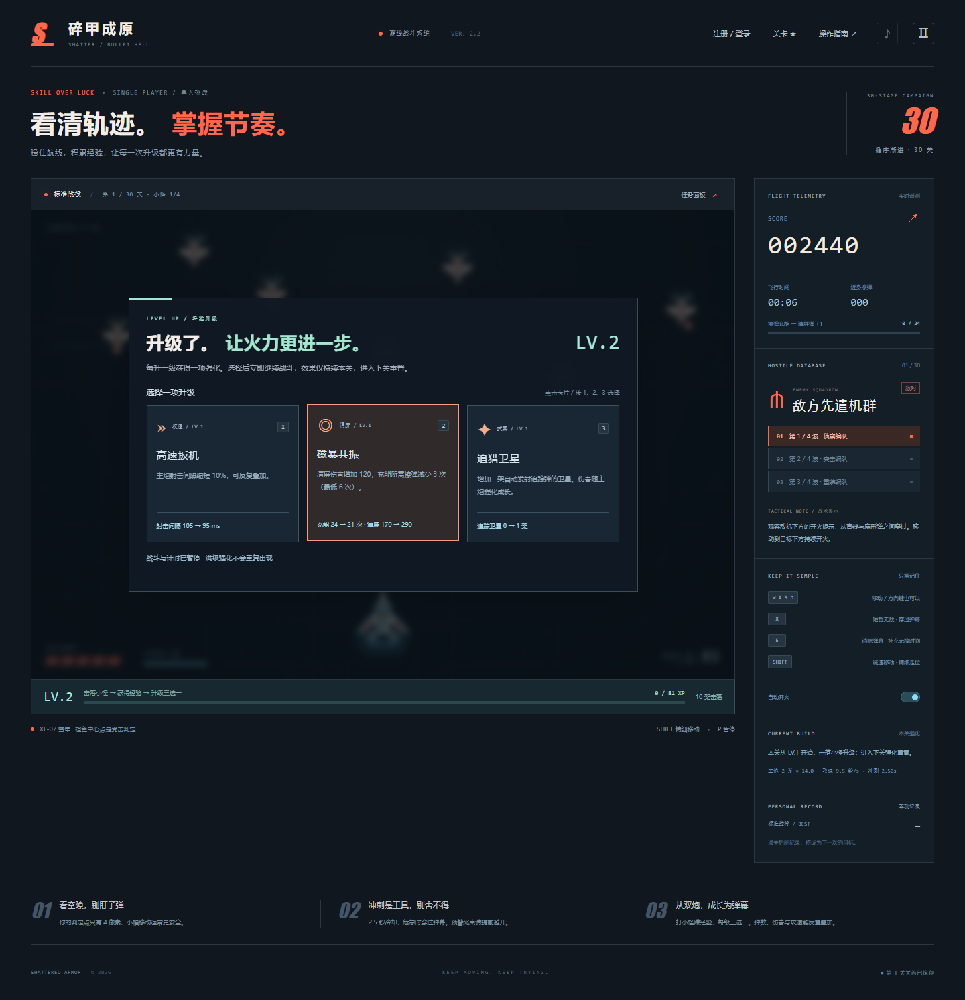
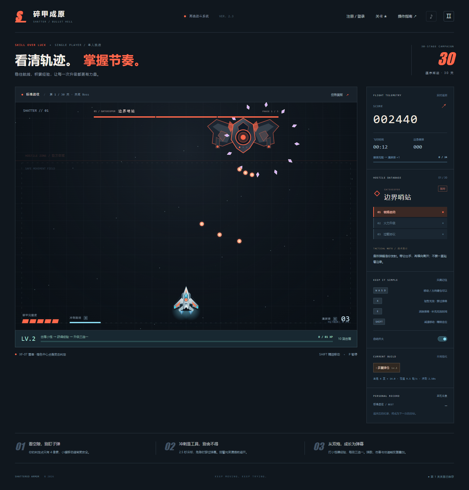
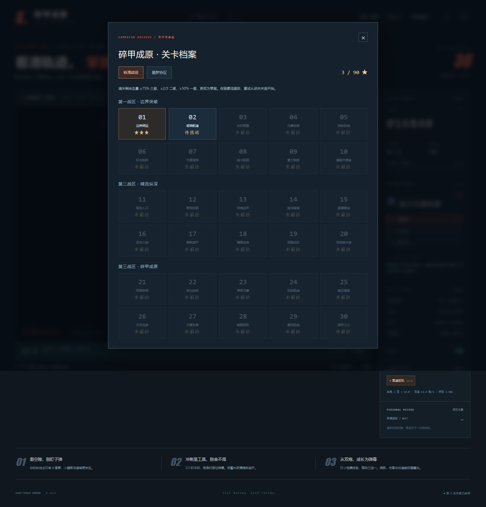
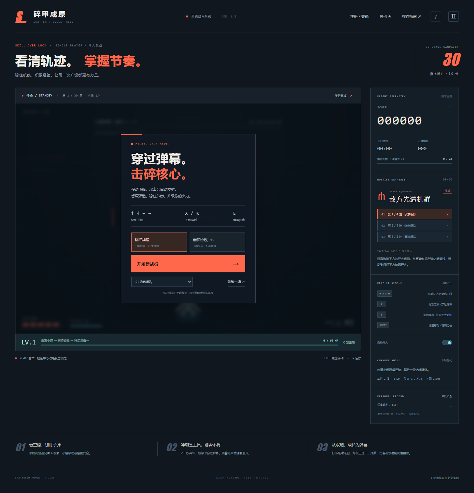
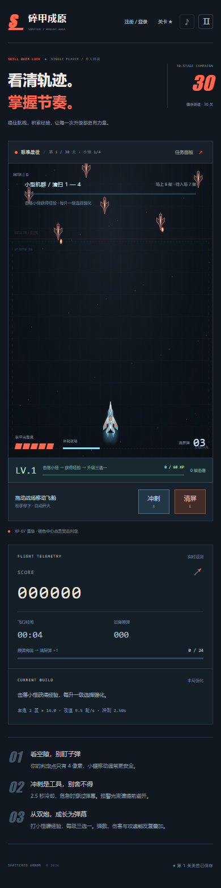

<div align="center">

# 碎甲成原

**SHATTERED ARMOR · 驾驶雪隼，穿越弹幕，让火力一路成长。**

30 关纵向射击战役 · 经验升级三选一 · 多阶段关底 Boss · 键盘与触屏

[🎮 立即开战](https://li198931834-byte.github.io/shattered-armor/) · [📖 完整游玩指南](docs/PLAYING.md) · [🐛 反馈问题](https://github.com/li198931834-byte/shattered-armor/issues)

无需安装 · 无运行依赖 · 支持单文件离线游玩



</div>

## 从双发主炮，到你自己的火力体系

驾驶 XF-07「雪隼」双引擎战机，在有规律的敌机编队之间寻找空隙。击落小怪积累经验，每次升级暂停战斗，从三项强化中选择一项：加子弹、叠伤害、提攻速，或带上追踪卫星和护盾。

每关先清扫三批机群，再迎接大型 Boss。穿过预警、扇形弹幕与激光，保持装甲完整度，拿下三星后进入下一关。

| 玩点 | 你能体验到什么 |
| :--- | :--- |
| **30 关完整战役** | 30 个关卡名称，三种 Boss 攻击范式逐步加强，第 10 / 20 / 30 关迎来强化挑战 |
| **能看见的火力成长** | 主炮从每轮 2 发成长至 12 发，搭配伤害、攻速、斜向弹、追踪卫星等强化 |
| **两次构筑机会** | 击落小怪升级获得三选一；前 29 关通关后还能选择一次关间强化 |
| **闪避有工具** | 无敌冲刺、清屏弹、精细减速与 4 像素核心判定，给极限穿梭留出空间 |
| **星级与关首重试** | 按通关剩余装甲评星，保留最佳成绩；失败后返回选关或从关首重来 |
| **标准 / 噩梦 / 练习** | 从 5 格装甲的标准模式入门，在噩梦中挑战 3 格装甲，也能单练任意关底 |

## 实机画廊

以下画面直接截取自当前版本的游戏运行界面。

### 升级，选择这一局的打法

不是只看数值的成长：弹仓、弹芯、攻速、卫星与护盾都会改变你的战斗方式。升级时暂停计时，选好再继续。



### 清扫机群后，关底 Boss 登场

三批小怪结束后出现 2.5 秒预警，再进入大型 Boss 战。多阶段攻击会切换节奏，转阶段时清空敌弹。



### 一关一关解锁，一星一星打回来

标准与噩梦分别记录星级，重玩只会提高最佳成绩；零星通关也能解锁下一关。



<details>
<summary><strong>展开查看开始界面与手机实机截图</strong></summary>



<div align="center">

</div>

</details>

## 现在就玩

**网页版：** [打开《碎甲成原》](https://li198931834-byte.github.io/shattered-armor/)，点击「开始新战役」。攻击默认自动发射，先专注于移动、冲刺和清屏。

**离线版：** 下载仓库根目录的 [`index.html`](https://github.com/li198931834-byte/shattered-armor/blob/main/index.html)，用新版 Edge / Chrome 直接打开即可。这是自包含文件，无需额外素材或服务器。

第一次建议选标准模式。尽量小幅移动，看空隙提前调整位置；危险时用 `X` 冲刺穿过弹幕，或按 `E` 清屏。Boss 练习模式支持无限复活，适合先熟悉招式。

| 操作 | 键盘 / 鼠标 |
| :--- | :--- |
| 移动 | `W A S D` / 方向键，也可以按住战场拖动 |
| 精细移动 | 按住 `Shift` |
| 无敌冲刺 | `X` / `K` / 鼠标右键 |
| 清屏弹 | `E` |
| 选择强化 | 点击卡片 / `1` `2` `3` |
| 暂停 / 继续 | `P` / `Esc` |
| 手动射击 | `空格` / `J`；默认自动开火 |

手机上在战场任意位置按住并滑动即可控制飞机，滑动位移放大 1.25 倍，跟随速度为键盘的约 1.7 倍；抬手立即停止，再按下不会把飞机拉向手指。使用下方的「冲刺」与「清屏」按钮。音效默认关闭，可在右上角开启。

## 星级怎么算？

按击破关底时「剩余装甲 ÷ 装甲上限」计算，评分发生在关间修复和强化之前。

| 剩余装甲比例 | 本关星级 |
| :--- | :--- |
| ≥ 75% | ★★★ |
| ≥ 2/3，且 < 75% | ★★☆ |
| ≥ 50%，且 < 2/3 | ★☆☆ |
| < 50% | ☆☆☆，仍算通关 |

## 本机账号与存档

支持在右上角注册、登录**本机账号**，各账号独立保存关卡、星级与关首进度。密码使用随机盐和 PBKDF2-SHA-256 派生后存储。

这是单人游戏的浏览器本地档案，不提供云端注册、找回密码或跨设备同步。账号和进度保存在当前浏览器，清除网站数据可能丢失；网页版与本地 HTML 的存档也不互通。首次注册会继承当前游客的已保存进度，之后各自独立。

进入新关时保存关首状态；失败、刷新或重新打开后可以从关首继续。关内尚未保存的经验不会带入重试，开始新战役会覆盖该模式当前的战役检查点。

## 本地运行与开发

游戏本身不需要安装依赖。下载仓库即可直接打开根目录 `index.html`，开发源码在 `dist/`。

使用 Node.js 22 或更新版本：

```bash
git clone https://github.com/li198931834-byte/shattered-armor.git
cd shattered-armor
npm test
npm run build
npm run serve
```

打开 <http://127.0.0.1:8096/> 游玩打包版，或打开 <http://127.0.0.1:8096/dist/> 调试模块源码。修改 `dist/` 后运行 `npm run build`，会更新可发布、可离线打开的根目录 `index.html`。

```text
shattered-armor/
├── index.html              # 自包含游戏，也是 GitHub Pages 入口
├── dist/                   # HTML / CSS / JavaScript 模块源码
│   ├── core.js             # 战斗、经验、强化与关卡逻辑
│   ├── render.js           # Canvas 战机与弹幕绘制
│   ├── auth.js             # 浏览器本机账号
│   ├── progress.js         # 星级与关卡记录
│   └── app.js              # 交互、界面与存档衔接
├── scripts/                # 打包、预览与实机截图
├── tests/                  # 逻辑测试与浏览器验收
└── docs/                   # 完整指南与实机截图
```

### 验证

`npm test` 包含 30 项自动化检查，覆盖移动与碰撞、经验发放、连续升级、强化效果、30 关状态推进、账号隔离、星级阈值和前期弹幕节奏。

需要运行浏览器验收或重拍截图时，保持 `npm run serve` 运行，在另一个终端执行：

```bash
npm install --no-save playwright
npx playwright install chromium
npm run test:browser
npm run screenshots
```

也可通过环境变量 `BROWSER_EXECUTABLE_PATH` 指向本机 Chrome / Edge。测试生成的临时截图保存在已忽略的 `artifacts/`，README 使用的六张实机图位于 `docs/screenshots/`。测试使用加速推进验证关卡衔接，不代表真人已通关噩梦 30 关。

### 发布

本项目通过 GitHub Pages 发布：`main` 分支，`/(root)` 目录。提交更新前运行 `npm test` 与 `npm run build`，推送后等待 Pages 自动部署。根目录 `.nojekyll` 让入口按静态文件发布。

发布方式参考 [GitHub Pages 官方文档](https://docs.github.com/en/pages/getting-started-with-github-pages/configuring-a-publishing-source-for-your-github-pages-site)。

---

**看清轨迹，掌握节奏。下一轮，让火力更强一点。**
